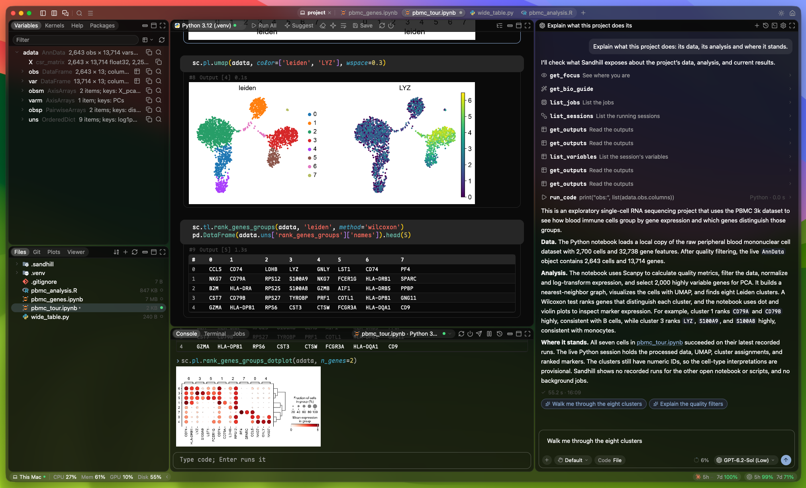

# Sandhill

A fast, light IDE for R and Python bioinformatics on Apple silicon Macs, with
AI agents that work in your live R and Python sessions. Run your analysis on
the Mac or on a Linux server over ssh; it keeps running when you close the
laptop.

> **Status:** early development (version 0.1.0). The app is for Macs with
> Apple silicon; servers can be any 64-bit Linux.




*Light and dark themes, with the window's frosted glass on (Welcome →
General).*

## Why Sandhill

**It stays fast with very large files.** Sandhill is a native Mac app,
written in Rust, with no Electron and no extension host. It only lays out
what is on screen, so a notebook of two thousand cells or a table of
thirty thousand columns opens in about a second.

**It leaves your memory for your data.** In every test we ran, Positron used
about 7 to 23 times as much memory as Sandhill. The memory goes to your R and
Python sessions instead.

**Work keeps running when you leave.** R and Python sessions, long jobs,
terminals and AI agents run in a small background program, on the Mac or on
your server. Quit the app, close the laptop or lose the network: everything
keeps going, and when you come back, every output is there, including what
was printed while you were away.

**AI agents in your live sessions.** Claude Code and Codex run unchanged
inside Sandhill. Each can see the variables, tables and plots you already
have in memory and run code in your sessions, instead of starting over from
your files.

### Measured against Positron

The same Mac, the same files and the same steps for both apps.


Positron is faster at opening the R script and the wide table, and scrolls
the large notebook a little more steadily (60 frames a second against
Sandhill's 57). It also runs on Windows and Linux and has the VS Code
extension marketplace.
[How we measured, and the full results](docs/comparison/positron.md).

## What's in it

- **Notebooks and scripts:** Jupyter (`.ipynb`), Quarto (`.qmd`) and
  R Markdown (`.Rmd`) notebooks with outputs under each cell, and R and
  Python scripts. Outputs are saved and come back when you reopen a file;
  Quarto and R Markdown outputs are kept next to the file in `.<name>.out/`.
- **The panes you know from RStudio and Positron:** Console, Variables, Data
  Explorer (sort, filter and column statistics, worked out in your session),
  Plots, Help, Packages, Viewer (HTML widgets, Shiny apps, Quarto preview),
  Git, Jobs and a Terminal.
- **R and Python, set up for you:** Sandhill finds conda, mamba and virtual
  environments and asks each project once which R and Python it uses. On a
  server with R it installs Ark, Posit's R kernel, so R runs with no setup.
- **Projects:** each analysis folder opens in its own window; open projects
  come back with their tabs at the next launch.
- **Skills and connectors:** add skills (instructions agents can follow) and
  connectors (databases and services agents can query, such as BioMCP, Open
  Targets, Consensus and Synapse) once, and every agent can use them.
- **Bioinformatics guides and checks** for agents doing single-cell and
  study-design work. These are still awaiting review by domain experts; see
  [their limits](docs/design/bioinformatics-assistance-plan.md).

## Get Sandhill

Every push to `main` builds Sandhill.app, with the background program
inside and Linux builds of it to install on servers. Open the **Mac app** run
on GitHub's Actions tab and download **Sandhill-macos-arm64** under
Artifacts (builds are kept for a week). The app isn't notarized yet, so after
unzipping run `xattr -dr com.apple.quarantine Sandhill.app` once, or macOS
will refuse to open it.

To build it yourself you need Rust, and Jupyter kernels for your languages:
ipykernel in your Python environment, and for R,
[Ark](https://github.com/posit-dev/ark) or IRkernel.

```sh
cargo build -p sandhill-daemon        # at the repo root, once
cd app
cargo run -- /path/to/project         # the folder is optional
```

## Work on a server

On the start window, click **+ Server…** and type the server as you would
after `ssh`: a `Host` from `~/.ssh/config`, or `user@host`. Open a folder
there, and the project window works as it does on the Mac.

- The app uses your Mac's own `ssh`, so your config, keys, ssh agent and
  jump hosts work as they do in Terminal. `ssh yourserver` must log in
  without a password (set up a key with `ssh-copy-id yourserver`).
- The first time, the app installs its background program, `sandhilld`, in
  `~/.local/bin` on the server. It needs no root, opens no ports, and runs on
  any 64-bit Linux, Intel or ARM.
- Sessions start with the `PATH` your login shell sets up, so conda and your
  usual tools are found.
- When the network drops, the app reconnects on its own and shows what was
  printed in the meantime.

## Agents

The chat button in the toolbar (⌘I) opens the AI pane. Each agent is the
real program, running in the project's folder on the machine the project is
on, with its own login and settings; Sandhill never sees your login.

- Agents reach your live sessions through Sandhill's tools: they list
  sessions and variables, run code and read outputs and plots, and the code
  they write lands in your document.
- Files an agent edits reload in the editor; if you changed the file too,
  you choose which version to keep.
- Conversations keep running when the app quits, and come back when the
  project reopens.

## How it fits together


The design, with the reasoning behind each choice, is in
[docs/design.md](docs/design.md).

| Path | What |
|---|---|
| `app/` | The Mac app, drawn with GPUI (its own Cargo project; see [app/README.md](app/README.md)) |
| `crates/daemon` | `sandhilld`: kernel sessions, output journal, agents, socket server |
| `crates/proto` | Wire protocol types and the async client the app and CLI share |
| `crates/link` | How the app reaches sandhilld: on this Mac, or over ssh (installing it there) |
| `crates/cli` | `sandhill`: terminal client, useful for scripting and testing |
| `packaging/` | systemd (server) and launchd (Mac local mode) service files |
| `docs/` | [Design](docs/design.md), [protocol](docs/protocol.md) and [decisions](docs/decisions/) |

### Try the background program on its own

```sh
cargo build --release                                # sandhilld and the sandhill CLI
./target/release/sandhilld serve &                  # or install packaging/systemd/sandhilld.service
./target/release/sandhill kernels
id=$(./target/release/sandhill start python3)
./target/release/sandhill run "$id" 'print("hello")'
./target/release/sandhill history "$id"             # everything that ran, even while you were away
```

Run the tests with `cargo test --workspace`, and `cargo test` in `app/` for
the app (on Linux it needs `libxkbcommon-dev libxkbcommon-x11-dev
libwebkit2gtk-4.1-dev` and X11). Kernel tests skip when a kernel isn't
installed.

## License

Sandhill is free and open-source software, and a non-commercial project:
there is no paid version. It is licensed under the GNU General Public License,
version 3 or (at your option) any later version; see [LICENSE](LICENSE). You
may use, change and share it, and a changed version you share must be under
the same license, with its source code.

Sandhill is not affiliated with Posit; Positron and Posit Assistant are
Posit's products.

The Maple Mono NF font the app ships is under the SIL Open Font License
([app/assets/fonts/OFL.txt](app/assets/fonts/OFL.txt)), and the libraries
Sandhill builds on keep their own licenses (MIT, Apache-2.0 and similar).
The interface and file/integration artwork comes from Gruvbox Material Icons,
Lucide and Developer Icons under their upstream MIT/ISC licenses; see the
[icon attribution notices](docs/design/ui/icons/vendor/NOTICE.txt) and
[source mapping](docs/design/ui/icons/MAPPING.md). Vendor trademarks remain
their owners' property.
The Posit Assistant and Antigravity marks use user-supplied references; their
public-release permissions are not supplied by those icon-library licenses.
