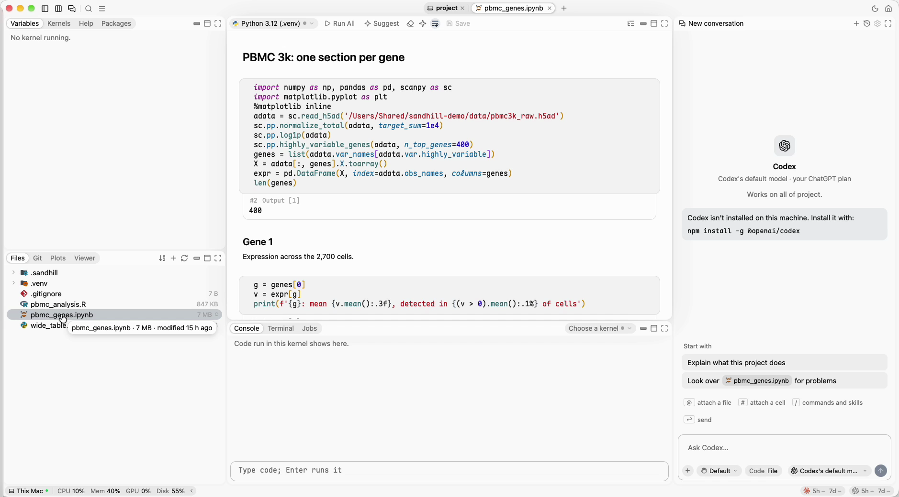
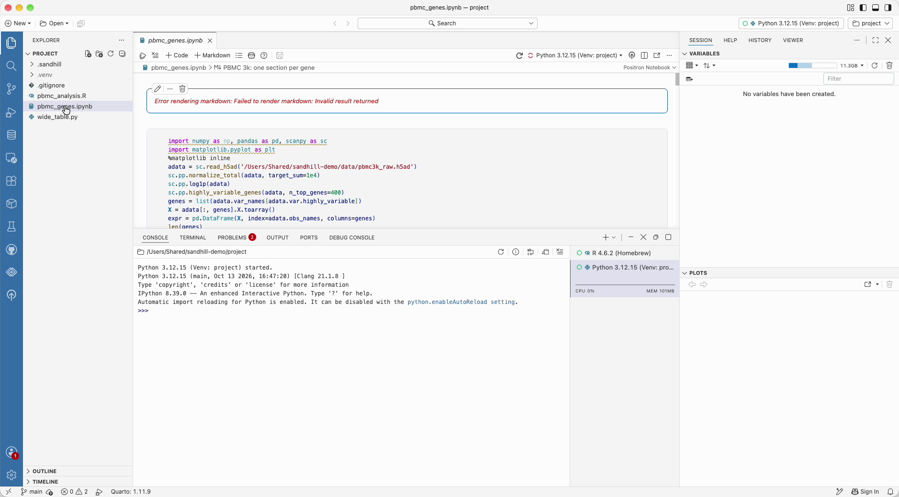
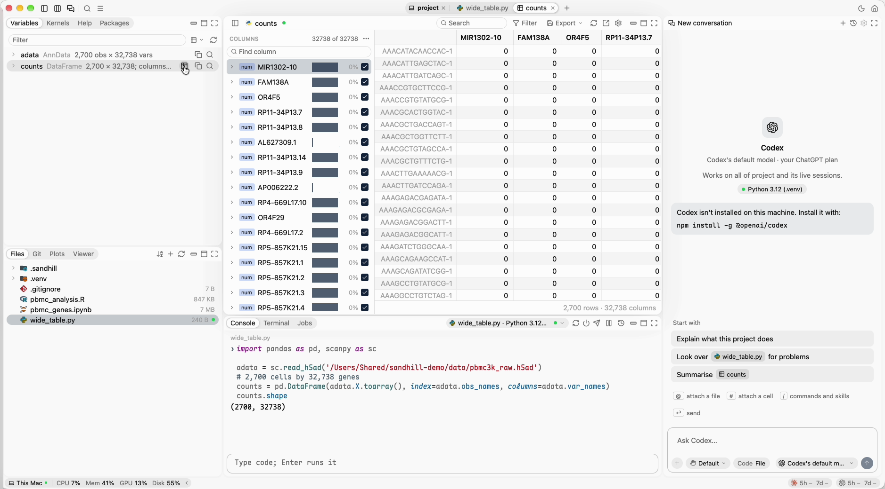
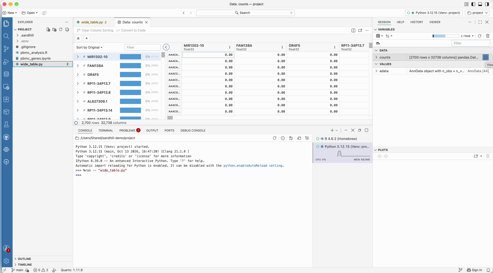

# Sandhill and Positron with very large files

**Draft for Huan's review (2026-11-17). Not published yet.**

Sandhill and [Positron](https://positron.posit.co) are both editors for data
analysis in R and Python. We timed the two on the same Mac, with the same
files, doing the same things. This page shows where Sandhill is faster and
where Positron is.

Sandhill is not affiliated with Posit. Positron is Posit's product and a very
good one; this page only covers what we measured.

## In short

- **Large notebooks:** Sandhill opened a 2,002-cell notebook in under a
  second; Positron took about three minutes and 4.5 GB of memory.
- **Memory:** Positron used about 7 to 23 times as much memory in every test.
- **Processor:** while scrolling and dragging, Sandhill used about a third
  to half the processor time Positron did.
- **Where Positron is ahead:** it opened the 30,000-line R script and the
  32,738-column table faster, and it scrolled the large notebook a little
  more steadily.

## The results

The middle value of five runs, after one warm-up run that wasn't counted.

| Test | Sandhill | Positron |
|---|---|---|
| Start-up, until the window stops changing | 2.1 s | 3.5 s |
| Memory after start-up | 137 MB | 955 MB |
| Open a 2,002-cell notebook (7 MB, 400 plots) | **0.64 s** | 180 s |
| Memory with the notebook open | **195 MB** | 4.5 GB |
| Open a 30,005-line R script | 0.76 s | **0.58 s** |
| Memory with the R script open | **155 MB** | 1.0 GB |
| Open a table of 2,700 rows and 32,738 columns | 1.05 s | **0.57 s** |
| Memory with the table open | **137 MB** | 1.6 GB |
| Scroll the notebook (frames per second; processor cores used) | 57 fps, 0.34 cores | **60 fps**, 1.12 cores |
| Scroll the R script | 60 fps, 0.22 cores | 60 fps, 0.40 cores |
| Drag a pane's edge, notebook open | **57 fps, no pauses** | first drags ignored; then 52 fps with three 0.2 s pauses per drag |
| Drag a pane's edge, R script open | **56 fps**, 0.22 cores | 38 fps, 0.76 cores |

The screen redraws 60 times a second, so 60 frames per second is the most
either app can show.

Memory is what Activity Monitor shows, added up over all of an app's
processes (Sandhill uses 3, Positron 13 to 15). The R and Python sessions
themselves are left out for both, because they hold your data, not the app.

### Opening the large notebook

Positron showed an empty notebook for about three minutes, while its window
process grew to almost 10 GB at its peak on our first try. When the
notebook appeared, Positron had marked it as changed although nobody had
edited it, and its first text cell read "Error rendering markdown: Failed
to render markdown: Invalid result returned".

### Scrolling and dragging

Both apps scroll and resize panes smoothly enough that the difference is
hard to see; the numbers show it in processor time more than on screen.
Positron held a steady 60 frames a second scrolling the large notebook;
Sandhill averaged 57, now and then missing a single frame (never two in a
row), while using about a third of the processor time.

Dragging the edge between two panes, Sandhill drew about 56 frames a second
with the R script open and Positron about 38. With the notebook open,
Positron ignored the first twelve seconds or so of dragging in every session
we ran (six of six), while using 1.7 processor cores; after that it followed
the pointer at about 52 frames a second, with three pauses of about 0.2 s in
each drag.

### Opening a very wide table

Both apps opened the table from their Variables pane. Positron showed it in
0.57 s, Sandhill in 1.05 s; Sandhill used 137 MB and Positron 1.6 GB.

## How we measured

- **The Mac:** Apple M1 Ultra, 64 GB of memory, macOS 27.2.1, a 60 Hz
  display. Both apps in the light theme, in the same 1878 x 1040 window, one
  app at a time.
- **The versions:** Positron 2026.11.1 (build 4); Sandhill 0.1.0 built from
  commit 3660059.
- **A fresh start each time:** Positron ran as a new install would, with
  empty settings and extensions folders; on its first start it installed
  the 15 extensions it comes with, and those were kept. Each run began from
  the same saved state of each app, with no files open and the other app
  closed.
- **The files:** made from the public 10x Genomics PBMC 3k dataset: a
  notebook of 400 genes with five cells each (code, a table, a plot), run
  for real so every cell has its output; an R script of 30,005 lines; and
  the dataset's full count table as a pandas DataFrame.
- **Timing:** the screen was recorded at 60 frames a second, and the time
  counted from the click until the app's window stopped changing.
- **Smoothness:** a script sent the same scrolling and dragging to both
  apps, after each app had finished working on the document. A frame that
  didn't change while the content was moving is a frame the app didn't
  draw.
- **Processor and memory:** read from macOS (`ps` and `footprint`) for all
  of each app's processes.

## Where Positron is the better choice

Positron runs on Windows and Linux as well as macOS, has the VS Code
extension marketplace and a debugger, and has a company behind it. In our
tests it opened the R script and the wide table faster, and scrolled the
large notebook a little more steadily.
