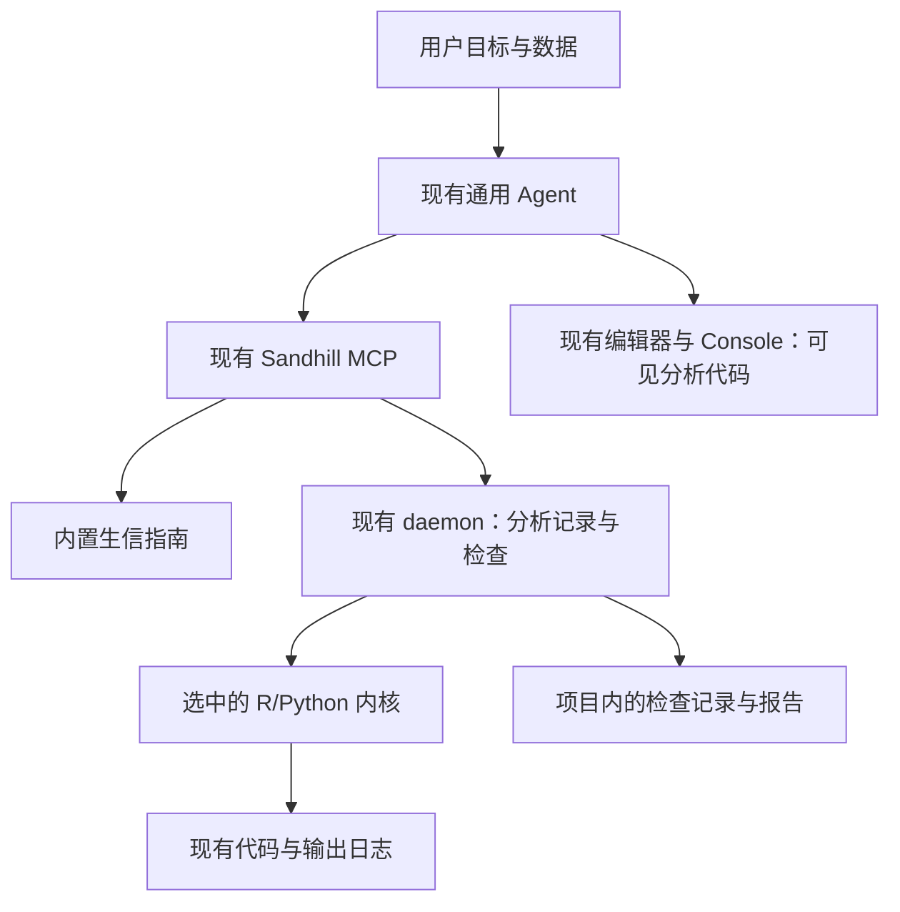

# 生信分析辅助：通用 Agent、审核技能与可验证检查

状态：Huan 已批准实施；2026-11-10 已接通指南、记录及检查，正在进行真实内核与官方原始 PBMC3k 验收。指南尚待领域人工审核，不能作为“已审核”的默认推荐。

Huan 已同意保留通用 Agent，补充生信技能、工具和必要检查，并明确 Python 分析与作图优先使用 omicverse，必要时使用其他工具。2026-11-10 另批准下载官方公开 PBMC3k 原始数据，在临时项目中运行 Python/R 两条验收；不安装或升级用户环境，不构建 Mac App。

## 1. 交付目标与边界

继续使用 Claude Code、Codex、Antigravity 和 Posit Assistant。它们负责理解目标、制定方案、编写及解释代码；Sandhill 提供统一技能入口、分析记录和由程序执行的检查。

首批形成两个完整、可独立使用的工作流：

1. **前期课题设计**：产出问题、证据、可证伪假设、实验单位、对照、混杂因素、分析与验证计划、停止条件。未检索或无法访问的引用明确标为未核实。这里只提供设计辅助，不把清单完整当成科学正确。
2. **PBMC/常规 scRNA-seq 探索分析**：Python/omicverse 优先（必要时 Scanpy 或其他工具）与 R/Seurat 两条路径，覆盖输入确认、质控、标准化、特征选择、降维、聚类、marker 和细胞大类注释；PBMC3k 作为公开验收案例。不是仅能识别 PBMC3k 文件名的特例。

不在本次交付范围：整合 omicOS/Biomni 等完整 Agent；训练模型；自动配置收费数据库；新建环境管理器、技能市场或新的 AI 面板；提供 bulk RNA-seq、空间组学、轨迹、细胞通讯和疾病差异分析的专用检查。现有通用分析功能照常可用，但这些任务不能获得本批检查的“通过”结论。

完整闭环通过验收后再发布；不先把只有提示词、没有检查的版本称为“准确性增强已完成”。

## 2. 已有代码与复用决定

代码核对，不是本轮运行证明：

- `crates/daemon/src/agents.rs`：四个官方 CLI 的启动、共用说明和 MCP 配置。Claude 使用追加说明；Codex 使用 app-server；Antigravity 通过现有桥接；PA 使用管理员默认设置，保留自己的终端界面。
- `crates/daemon/src/mcp/mod.rs`：MCP 初始化说明、工具目录、调用分发及 Ask 只读限制。
- `crates/daemon/src/mcp/documents.rs`：`add_cell`/`edit_cell` 和每条消息的文档上下文。
- `crates/daemon/src/mcp/session.rs`：变量、图、表格、帮助和已安装包信息。
- `crates/daemon/src/session.rs`、`journal.rs`：真实内核执行和持久化代码、输出、运行结果。
- `crates/daemon/src/server.rs`、`crates/proto/src/lib.rs`：本地/远程共用请求路径。

因此不新增 Agent 运行时、不增加守护进程、不接管 CLI 登录、不复制数据库或内核管理。Scanpy/Seurat 仍在选中的实际计算环境中运行，不把每个函数包装成单独 MCP 工具。

## 3. 技能：标准格式，共用发现，不写用户配置

内置四份自己编写的指南，采用 Agent Skills 的 `SKILL.md` 格式：

- `bio-study-design`：前期课题与实验/统计设计。
- `scrna-scanpy`：保留此稳定 ID；Python 单细胞探索分析及作图优先 omicverse，明确 Scanpy 等工具的适用缺口。
- `scrna-seurat`：R 单细胞探索分析。
- `bio-results-review`：区分执行成功、技术检查、统计适用性和生物学结论。

每份包含适用范围、先决条件、必问信息、流程、禁止的推断、检查点、来源、修订号及审核状态。参考资料按需读取，不把整套指南塞进每条消息。

审核发布规则：标明作者、审核人、审核日期、修订号和参考来源；未获得 Huan 或其指定领域审核人的确认，不标为“已审核”，也不作为默认推荐指南。AI 自查不冒充独立领域审核。内置技能是 Sandhill 自己的内容，不直接复制其他项目许可不明的技能。

**统一入口**为现有 MCP 中的 `get_bio_guide`：

- 不带 `id`：返回上述四项的名称、用途、审核状态和内容摘要标识。
- 带 `id`：返回指南正文和版本；读取配套参考资料使用目录中列出的相对资源名，不接受任意文件路径。
- 只读；不启动内核，不安装软件，不下载数据。

在 MCP 初始化说明、工具描述和现有共用 Agent 说明中加入简短使用规则：遇到生信设计/分析先查看适用指南，分析代码留在用户文档，结束前请求程序检查。PA 通过 MCP 说明和工具入口获得相同内容，不假设它支持 Sandhill 其余三个 Agent 的消息注入机制。

不向用户的全局技能目录、`AGENTS.md`、`CLAUDE.md` 或 Agent 设置写入内容；不分别维护四套技能副本。用户可以明确要求“按 Sandhill 生信规范分析”。自动选择由 Agent 决定，不能承诺每次自动加载；指南调用记录只证明提供过内容，不证明模型遵守了全部内容。

## 4. 分析记录：可追溯，不建立第二套输出数据库

新增三个共用 MCP 工具，与三个同名含义的 wire 请求对应：

| MCP 工具 | wire 请求 | 合同 |
|---|---|---|
| `begin_analysis` | `BeginAnalysis` | 建立项目分析记录，绑定工作流、指南版本、输入声明和输出位置；单细胞工作流另绑定明确的现有会话及对象，不替用户选择另一环境 |
| `check_analysis` | `CheckAnalysis` | 按 `design` 或 `input`、`qc`、`result` 检查点执行内置检查，生成带实际依据的检查记录 |
| `get_analysis` | `GetAnalysis` | 读取某条记录及检查依据；不自动重新执行分析或检查 |

加上 `get_bio_guide`，总计四个新 MCP 工具、三个新 wire 请求；不增加公开 CLI 子命令、环境变量、付费账号或常驻服务。

`begin_analysis` 要求明确的项目、指南和工作流。`study_design` 不要求任何 R/Python 会话，不启动内核；`scrna` 要求明确的现有会话，内存对象仅接受变量名，参数经 JSON 编码，不作为任意代码表达式拼接。AnnData counts 层、Seurat assay/layer、样本/供体/分组列由记录明确指定；不能仅因矩阵“像整数”就认定它是未经处理的原始计数。

分析的权威状态写入已有 daemon journal 的新增 `analyses`、`analysis_checks` 表：分别保存项目归属及记录版本、程序产生的检查结果及其实际 run ID/内容摘要；不新建第二个数据库。Agent 提交的目标、参数和实验信息明确标为声明，不混同于程序测量事实。`get_analysis` 从 journal 读取检查结论，不能把项目里由 Agent 写出的“全部通过”文件导入为已验证状态。

在实际分析设备的 `.sandhill/analysis/<id>/` 同时生成可读导出：

- `manifest.json`：记录格式版本、分析 ID、工作流、指南 ID/摘要、目标、输入来源及文档路径；单细胞工作流另存实际会话、对象及计数来源、输入文件摘要、实验设计声明和参数。
- `study-design.json`：仅用于课题设计，保存研究问题、已有证据/推测、可证伪假设、实验单位、分组/配对、混杂因素、主要结局、分析方法、样本量依据、独立验证、停止条件、来源及未解决问题；由 Agent 生成并供用户审核。
- `checks/<check-id>.json`：每次检查单独保存；检查程序版本、代码/输入/结果摘要、时间、检查项和依据；执行内核检查时带实际 run ID，纯设计结构检查不伪造 run ID。旧检查不覆盖。
- `report.md`：由程序根据这些记录生成，列出已核查事实、失败项、未检查项和待人审核问题；模型的生物学解释另放普通分析文档，不冒充程序结论。

分析代码继续使用现有 notebook/Quarto/脚本与运行日志；常规结果写入项目 `results/<analysis-id>/`，或用户明确选定的输出位置。被检查的最终对象必须保存为 `.h5ad`/`.rds`，供结果检查重新读取，不能只验证内存中的另一个对象。

输入文件只读使用，所有 managed 输出拒绝与输入、代码文档和检查证据路径、硬链接目标或符号链接解析后的目标重合；已有非本程序拥有的输出不静默覆盖。不批量复制整个 counts 矩阵：磁盘来源保存内容摘要，内存/保存对象按稀疏块检查，避免将完整表达矩阵变成稠密矩阵。

权威状态在 journal 中以事务提交；项目导出原子写入。导出失败要明确报告并可从权威记录重新生成，不能声称文件已保存。并发修改同一个分析记录时串行处理。会话、文件和记录的归属在 daemon 侧校验，不仅在 MCP 参数说明中声明。跨项目的同名对象不得串用；导出内容被手动改动时不接受其替代程序检查结果。

指南/检查程序摘要必须匹配：旧 Agent 持有旧 MCP 版本时明确要求重新启动该 Agent 会话，不静默换用新规则。旧 daemon 不支持新请求时明确报告功能不可用，不伪装成检查通过。旧项目文件无需迁移，journal 按已有机制增加表，不修改旧表/旧请求含义。

## 5. 具体检查：事实检查与科学判断分开

检查脚本由 Sandhill 发布，不接受 Agent 传回一段“全部通过”的 JSON 当证据。通过现有会话 actor 执行固定 Python/R 检查代码，实际执行写入现有 journal；在 actor 接收处检查忙状态，避免先检查空闲、再排队插入繁忙会话的竞争。繁忙就返回未检查原因，不停止用户代码、不另起内核、不等待几个小时再给出伪及时结果。

检查代码使用函数局部作用域，不改变用户对象、工作目录、随机状态或软件选项。只返回有界摘要；包版本取自实际会话，不取 Agent 的口述。

### 课题设计检查点

`design` 由 Rust 对 `study-design.json` 执行结构和一致性检查，不运行 R/Python。必需字段缺失、来源条目没有 URL/文献标识、样本单位未定义或验证/停止条件未说明，都明确列出；未知项必须写成未解决问题，不能凭空补齐。不得把“尚未确定”视为已满足设计要求。

检查报告分别列出字段完整性及尚待审核的问题；不会把仅能解析的 DOI/URL 当成引用真实存在、支持该论点或证明创新性的证据。来源真实性、样本量依据和设计是否足以识别因果，均保留人工审核状态。没有重复信息的治疗/疾病比较只能形成待解决设计问题，不能获得“设计充分”的结论。

### 输入检查点

- 输入格式、对象类别、矩阵维度、唯一细胞/基因标识及其对应关系。
- 显式 counts 来源是否存在；是否有限、非负，以及是否与所声明的计数类型一致。
- `log1p`/归一化信息及 counts/data/layer 位置；存在矛盾或原始计数来源不明时停止 raw-count 工作流，不能自动再标准化。
- 实际 R/Python、主要包版本、所需接口、随机种子和输入来源；缺包只给出安装目标与建议，不自动安装或升级。
- 基因 ID 类型和物种；无法识别线粒体基因时显示未确定，不能把未匹配到的基因当作 0% 线粒体比例。
- 记录研究目标和生物学重复信息。PBMC3k 是单个健康供体的教程数据，不支持治疗/疾病效应推断。

### 质控检查点

- 使用 counts 重算质控指标并与保存指标核对。
- 保存阈值、选择理由、过滤前后细胞/基因数及排除原因；阈值不是所有数据通用的 5%/20% 常数。
- 验证保留细胞和基因是输入的对应子集，顺序/metadata 对齐，保留下来的原始计数未被标准化或覆盖。
- 缺失信息和不适用步骤有显式理由；不把“未做 doublet 检查”自动视为已排除 doublet。

### 结果检查点

- `.h5ad`/`.rds` 实际可重新读取；维度、标识、metadata、聚类与 embedding 一致，数值有限。
- PCA、邻居/聚类、UMAP 参数与随机种子有记录；代码、关键执行及包版本可追溯。
- marker 来源及使用的表达层明确，使用约定的多重检验校正结果；聚类后 marker 的显著性只作探索性证据，不当作独立验证。
- Python marker 保留完整实际检验家族的原始及校正 p 值于保存对象中；导出表可取 top 子集，但不能仅用该子集重算 BH 校正。R/Seurat 的 Bonferroni 使用实际完整基因数及原始 p 值验证。
- 注释表每群包含候选大类、多个 marker 的表达比例/表达摘要、冲突证据、来源和确定/待审说明。程序检查表和对象对应，并重算所引用表达摘要；不以单一 NKG7 命中自动判 NK，也不以“列了两个基因”判定生物学正确。
- 不支持的注释物种/组织或证据不足保留 unknown/待审。PBMC marker 参考不能自动用于所有组织。
- 无有效实验设计时不批准治疗/疾病对比；细胞群 marker 不包装成有生物学重复的组间差异结论。本批不实现疾病组间差异分析的“检查通过”。

项目采用 `pass`、`warning`、`fail`、`not_checked` 四类逐项结果。必需项未检查不能通过；非适用性由工作流合同决定，不能由 Agent 任意声明跳过。报告明确区分“技术检查通过”和“科学判断待审核”，不提供“分析准确率 100%”或“科学正确”总徽章。

**时效性**：检查只对当次输入、代码和结果摘要成立。后续运行、文件修改、内核重启或关键版本变化使旧依据不能代表当前结果；`get_analysis` 显示历史时间及已知变化，最终交付前必须重新检查。未重新读取/核验的内容不标为当前有效。显式清理 daemon 分析历史时一并清理新增权威历史表，但保留项目 `.sandhill` 导出和结果；这些导出此后仅是历史文件，不能重新导入成当前通过状态。不得留下引用已删除 run 却仍显示完整可追溯的记录。

结果请求的 `execution_run_ids` 最多 32 项，daemon 从同一实际会话的 journal 核对成功完成的执行、代码及摘要。MCP 执行回复和 Console 历史提供真实 ID；不接受 Agent 自写执行证明。参数/种子属于记录及执行来源，程序比较库实际保存的字段；不把未被库输出的内部 RNG 状态伪装成测量事实。最终结果检查在同一次 actor 执行中重查原有 QC 约束，避免 QC 之后修改 counts 而仅凭“保存对象等于内存对象”通过。
生成报告的替换在原子重命名前复核目录句柄、文件身份和内容/metadata；
无法排除不合作外部进程在最后系统调用间隙写入。因此以 journal 和独立
检查记录为权威，不以可编辑报告文字为权威，不宣称操作系统级隔离。

## 6. 执行安全、人工确认与产品呈现

沿用现有审批：`get_bio_guide`、`get_analysis` 为只读；`begin_analysis` 创建记录、`check_analysis` 执行检查并写报告，不能加进无条件只读放行列表。Ask/Plan 在本批四个工具中只允许读取指南和历史，不执行新检查或写记录；不改变其他既有 Plan 工具的权限。安装软件、下载数据、访问收费服务仍需用户明确授权；普通生信问题只加载指南，不自动开始完整流程。

不做独立的“生信模式”大面板。直接使用现有 AI 工具步骤显示指南 ID/审核状态、选定环境、检查点和失败依据；报告作为普通 Markdown 文件打开，R/Python 代码和输出仍在现有文档及 Console。

有一条必须公开的限制：官方通用 CLI 仍能通过自己的 shell/文件工具运行代码。此方案不是操作系统沙箱，不能阻止所有绕过，也不能阻止模型在普通聊天里口头声称完成。程序只对真正通过检查入口产生的记录负责；未经检查的分析不获得 Sandhill 的检查结论。若要求隔离所有任意命令，那是另一个需要单独设计和批准的沙箱工程。

初始指南在领域人工审核前保持未审核状态。每次分析至少人工审核设计合理性、质控取舍和注释/结论；多个模型互评不等同于独立生物学验证。

隐私：不新增云端上传服务，完整矩阵不默认送入提示词。但现有 Agent 本身仍可能把问题和工具摘要发给所选模型供应商，不能宣称全程离线。网页关闭或网络不可达时，引用必须标为未核实；本地分析不依赖在线文献查询成功。

## 7. 改动范围与实施顺序

这是跨模块改动，超过八个文件，加上四份指南和 Python/R 资源；不是小补丁。生产逻辑仍以 Rust 实现；Python/R 仅为现有分析内核运行的检查与示例，不引入 Node、额外常驻 Python 服务或新的内核协议。

| 范围 | 具体职责 |
|---|---|
| 新增 `crates/daemon/src/bio/`：`mod.rs`、`guides.rs`、`analysis.rs`、`checks.rs` | 内置目录、记录合同/存储、检查调度和报告生成 |
| 新增 `crates/daemon/assets/bio/` | 四份标准技能、明确来源的 PBMC marker 参考，以及固定 Python/R 检查脚本；发布时嵌入 daemon |
| 新增 `crates/proto/src/analysis.rs`；修改 `crates/proto/src/lib.rs` | 分析记录/检查结果类型，三个新请求；保持现有请求合同 |
| 修改 `crates/daemon/src/lib.rs`、`server.rs`、`session.rs` | 注册模块、daemon 分发、actor 侧原子忙状态检查与已有运行日志复用 |
| 修改 `crates/daemon/src/journal.rs` 和受影响的清理历史调用 | 增量表迁移、权威检查记录、事务一致性，以及显式历史清理时删除对应索引；保留项目数据 |
| 新增 `crates/daemon/src/mcp/bio.rs`；修改 `mcp/mod.rs`、`agents.rs` | 四个工具、统一技能发现和简短使用说明；保留所有现有权限 |
| 新增 `crates/daemon/tests/bioinformatics.rs`；调整现有协议/MCP/Agent 测试中受影响合同 | 真 R/Python 内核验证、跨项目/断连/失败/权限边界 |
| 文档 | 本方案、`docs/design.md` 索引、`docs/protocol.md` 新请求、README 使用与限制 |

按依赖实施，不把未完的中间状态当作完整功能发布：

1. 定义四份指南、范围、来源、检查合同及人工审核标准。
2. 实现指南入口和 daemon 分析记录，接通现有权限与远程 wire。
3. 实现 Python/AnnData 与 R/Seurat 检查脚本、记录时效性和输出报告。
4. 接通四个 Agent 共用 MCP 发现；复用现有 UI 展示，不改模型选择或会话归属。
5. 完成下列验收后交付。没有通过领域审核的指南不标“已审核”。

回退：旧项目文件无数据迁移；移除新增工具和代码即可停止提供此能力，已有 notebook、`.h5ad`、`.rds` 和项目记录仍保留。journal 迁移只增加新表，回退不要求删表或改写旧记录；历史导出不冒充仍有效的检查。关闭/失败不能自动删除分析结果或停止其他用户会话。

## 8. 验收与准确性证据

2026-11-10 已在本机实际验证：`bioinformatics` 集成测试 8 项通过（含真实
omicverse/Seurat 路径）、报告发布安全单元测试 2 项通过、Ask/Plan 工具限制
测试通过；根工作区格式与 Clippy 检查通过。未构建 Mac App。

经 Huan 授权，从官方 10x PBMC3k 原始 2,700 细胞矩阵分别执行 Python
omicverse 2.3.2 和 R Seurat 5.5.1 流程。两者按本次明确阈值均保留
2,638 细胞、16,579 基因；原始输入、QC、结果三个检查点技术通过。
实际完成 QC 图、PCA/邻居/聚类/UMAP、完整 marker 检验、带冲突/待审状态的
候选注释表、保存对象重读与执行来源检查。此结果不表示细胞类型已人工确认，
也不表示单供体数据支持治疗/疾病推断。验证使用临时项目，不改用户分析环境。

以下保留验收范围；真实 Claude/Codex/Antigravity/PA 模型是否自动发现并
调用工具尚未通过实际模型任务验证，不据此宣称 Agent 自动调用可靠。

### 确定性与真实内核集成测试

- 使用小型、已知内容的稀疏计数矩阵构造正确输入及对应错误：负数/非有限值、重复 ID、metadata 错位、counts 丢失、处理状态冲突、过滤后错配。每个错误必须产生对应失败/未检查原因，不能只测“不崩溃”。
- 课题设计无需内核即可创建/读取记录；缺实验单位、来源标识或验证条件必须被识别；仅有格式正确的 DOI 不能产生“文献已核实”或“科学设计通过”。
- 针对 AnnData 和 Seurat 分别证明：正确结果通过结构/一致性检查；人为改坏同一条路径会失败；保存/重读与内存结果不一致会失败。
- marker 证据摘要必须与对象中重新计算的值一致；缺少/冲突证据不能产生自动科学正确结论。
- Agent 手写/修改导出“通过”报告不能替代 journal 中的真实检查；导出失败、daemon 重启和显式历史清理后，不能出现未保存却报告已保存、或依据已删却仍声称当前可验证的状态。
- 忙内核、并发记录、超时、断连、内核结束/重启、结果后改、旧版本、缺包、跨项目、无写权限及 Ask 限制均有明确行为。超时不能自动重跑用户分析；未完成运行不产生通过结果。
- 缺内核/包的测试按照项目惯例明确跳过，但实际发布验收必须拥有 Python/Scanpy 与 R/Seurat 两条成功路径，不能用“全部跳过”替代。
- Agent 启动/工具调用合同复用现有 Claude/Codex/Antigravity/PA 测试模式；不以 stand-in 证明真实模型会自动选择技能。

实施后主要检查命令：根目录 `cargo fmt --all --check`、`cargo clippy --workspace --all-targets -- -D warnings`，以及 `cargo test -p sandhill-daemon --test bioinformatics`、相关协议/MCP 测试。最终交付遵守仓库检查要求；不因只有文档设计就提前运行这些命令。若实现中确需改 GPUI，则先补充 UI 范围，获得构建授权后按 GPUI 规则验证真实界面。

### PBMC3k 端到端验收

- 授权后使用官方原始 PBMC3k 输入，在 Python 和 R 中各完成一份分析；不使用已经处理好的对象冒充从原始数据开始。
- 明确初始原始输入为官方示例的 2,700 个细胞；过滤后的数量取决于记录的参数，不把某个教程保留数量或聚类编号写成通用正确答案。
- 可见代码、质控图、UMAP、marker/注释依据、可重读对象、环境版本、参数、输入摘要和检查报告齐全；断开再连接仍可读。
- 不要求 R/Python UMAP 坐标或簇编号一致；不同方法和版本本来可能不同。由领域审核人检查大类注释和冲突证据，而不是比较图片是否像教程。
- 对“用 PBMC3k 证明治疗引起免疫变化”的请求，必须明确其单供体、无治疗对照的边界。
- 每个真实 Agent 的自动发现需经用户授权的实际任务检查，记录 CLI/模型/技能版本、是否调用指南、是否调用检查、结果和遗漏；未验证的 Agent 不宣称自动选择可靠。

### 是否真的更准确

发布说明只陈述已验证的错误检出与工作流行为，不宣称胜过专业 Agent。后续比较使用同模型、同数据和任务，固定/记录模型设置并重复运行；对照现有助手与增加本能力后的助手，分别评价数据/统计错误、无证据结论、必要检查漏执行和可复现性。PBMC3k 是功能验收和示例，不是独立生物学真值，也不足以证明对疾病、多供体或其他组织的泛化准确性。

## 9. 依赖、风险与来源

- 新增必需第三方账号/API 密钥：无。沿用现有 Agent 自己的登录；模型使用和计算仍可能收费。
- Scanpy/Seurat 等软件由分析环境提供，缺失时指出当前设备和目标环境并请求安装授权；不自动建 conda 环境或改用户依赖。
- BioMCP 等外部服务不作为本次交付前提。用户日后选择时单独列出安装、数据许可和密钥要求，不在本次计划中默认为已接通。
- 最脆弱的假设是“模型会遵守提示”。因此检查结论从程序产生，不从模型的自述产生；同时明确这不是对任意 CLI 行为的强制隔离。
- 数据体量放大时，检查按稀疏块处理、摘要有界，不向模型发送整个矩阵；无法在资源限制内完成就报告未检查，不降成抽样后仍声称全量通过。
- 没有程序能仅靠格式和 marker 表自动证明统计/生物学正确，领域人工审核是交付条件的一部分。

参考依据（本轮查阅，引用方法和合同，不复制许可不明的实现）：

- [Agent Skills 标准](https://agentskills.io/specification.md)：标准目录和渐进加载；不是权限保证。
- [Posit Assistant Skills](https://assistant.posit.co/docs/features/skills/)：自动/手动加载的使用模式；不复制 Posit 的代码或内置技能。
- [Scanpy PBMC3k 教程（官方标记 legacy）](https://scanpy.readthedocs.io/en/latest/tutorials/basics/clustering-2017.html)：数据来源及教程基线，不作为所有新数据的默认最佳实践。
- [Seurat PBMC3k 教程](https://satijalab.org/seurat/articles/pbmc3k_tutorial)：R 路径、counts/data 层含义及 marker 参考。教程阈值不是通用阈值。
